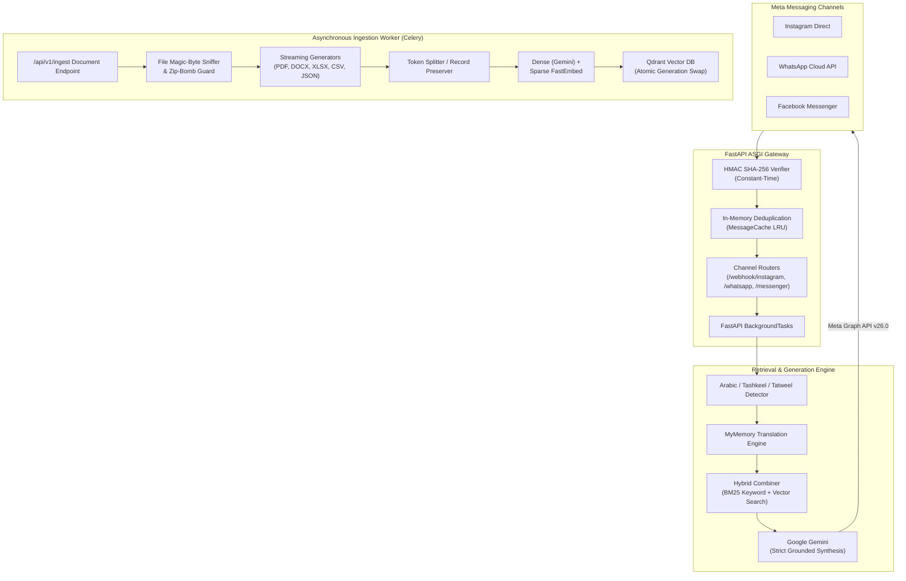

# 🤖 Smart Model — Omnichannel AI Assistant & Hybrid RAG Engine

<div align="center">

---

> [!WARNING]
> ### 🚧 Project Status: Under Active Development
>
> This repository is currently under **active architectural development and pre-release testing**.
> Core components such as Meta webhook handlers, streaming ingestion pipelines, and hybrid retrieval are functional and covered by **233 automated unit, integration, and stress tests**. However, certain modules (distributed state caching, multi-user chat session persistence, and semantic reranking) are actively evolving. See the [Current Limitations &amp; Roadmap](#-current-limitations--development-roadmap) section for exact details.

---

## 📑 Table of Contents

- [Architectural Overview](#-architectural-overview)
- [System Architecture Diagram](#-system-architecture-diagram)
- [Core Features](#-core-features)
  - [1. Omnichannel Meta Messaging Webhooks](#1-omnichannel-meta-messaging-webhooks)
  - [2. Streaming Document Ingestion Pipeline](#2-streaming-document-ingestion-pipeline)
  - [3. Hybrid Retrieval &amp; RAG Synthesis](#3-hybrid-retrieval--rag-synthesis)
  - [4. Security, Deduplication &amp; Anti-Abuse](#4-security-deduplication--anti-abuse)
- [Project Directory Structure](#-project-directory-structure)
- [Current Limitations &amp; Development Roadmap](#-current-limitations--development-roadmap)
- [Test Suite &amp; Quality Assurance](#-test-suite--quality-assurance)
- [Environment Configuration](#-environment-configuration)
- [Local Setup &amp; Getting Started](#-local-setup--getting-started)

---

## 🏛 Architectural Overview

Smart Model is designed to solve two core challenges in real-world conversational AI:

1. **High-throughput social messaging ingest:** Meta (Instagram Direct, WhatsApp Cloud API, Facebook Messenger) webhooks require immediate HTTP `200 OK` handshakes under high concurrency, strict HMAC verification, message deduplication, and background task dispatch without blocking ASGI worker threads.
2. **Safe, bounded-memory RAG ingestion:** Ingesting large business documents (PDF, DOCX, XLSX, CSV, JSON) without memory bloat, preventing partial indexing through atomic versioning (generation swapping), and guaranteeing zero hallucination via strict context grounding.

---

## 📐 System Architecture Diagram



---

## 🌟 Core Features

### 1. Omnichannel Meta Messaging Webhooks

- **Instagram Direct Messages**: Processes incoming customer inquiries, extracts ad referral payloads (Click-to-Instagram Direct ads), handles reply-to contexts, and suppresses bot echo loops.
- **WhatsApp Cloud API**: Integrates with WhatsApp Business Platform, supporting text, location, contact cards, documents, interactive buttons, and message context quoting.
- **Facebook Messenger**: Fully compliant with Messenger Platform API, handling quick replies, delivery watermarks, read receipts, and ad referrals.
- **Resilient Delivery**: Retries failed Graph API outbound replies using an asynchronous client with exponential backoff and concurrency semaphores.

### 2. Streaming Document Ingestion Pipeline

- **$O(\text{Batch Size})$ Memory Profile**: Documents are processed via Python generators. Nothing—neither raw rows, chunks, nor embeddings—is ever materialized fully in memory.
- **Pre-Chunked Table & Record Preservation**: JSON objects, CSV rows, and Excel rows preserve their relational key-value structure as discrete documents rather than arbitrary character splits.
- **Atomic Generation Swap**: Every document ingestion generates a unique `generation_id`. Old versions of chunks are only deleted *after* all new chunks have successfully upserted into Qdrant.
- **Self-Healing Rollback**: Any mid-ingestion failure triggers an immediate automatic purge of partial chunks written under that generation.
- **Crash Recovery Sweep**: A background `purge_orphaned_generations` routine cleans up orphaned chunks abandoned due to hard worker kills (OOM, SIGKILL).

### 3. Hybrid Retrieval & RAG Synthesis

- **BM25 Keyword + Dense Vector Fusion**: Combines exact lexical matching (BM25Okapi) with semantic vector search, interleaved and deduplicated for high relevance.
- **Arabic Language & MENA Specialization**:
  - Detects standard Arabic, Egyptian/Levantine dialects, Tashkeel diacritics, and Tatweel/Kashida elongation.
  - Translates colloquial queries to English for optimal cross-lingual retrieval while instructing the LLM to reply in Arabic.
- **Strict Anti-Hallucination Grounding**: RAG prompts enforce explicit source constraints—if facts are missing, the assistant reliably answers with *"I don't know"*.

### 4. Security, Deduplication & Anti-Abuse

- **Constant-Time Verification**: Uses `hmac.compare_digest` to prevent timing attacks on all webhook signatures (`X-Hub-Signature-256`).
- **Zip Bomb & Decompression Guard**: Inspects `.docx` and `.xlsx` archives before extraction to reject malicious expansion attacks (`check_zip_expansion`).
- **Magic-Byte Sniffing**: Inspects initial file headers to prevent executable or script files disguised under document extensions.
- **Thread-Safe Deduplication**: Thread-safe LRU `MessageCache` guards against Meta double-delivery network storms and concurrent retry floods.

---

## 📁 Project Directory Structure

```text
smart-model-project/
├── main.py                               # FastAPI application entry point & lifespan manager
├── pytest.ini                            # Pytest configuration & asyncio mode settings
├── requirements.txt                      # Production runtime dependencies
├── requirements-test.txt                 # Isolated test runner dependencies
├── todo.md                               # Active development task tracker
│
├── src/
│   ├── core/
│   │   ├── cache.py                      # Thread-safe LRU message deduplication cache
│   │   ├── celery_app.py                 # Celery distributed task queue configuration
│   │   ├── config.py                     # Pydantic Settings & environment variable validation
│   │   ├── container.py                  # Dependency injection service container
│   │   ├── http_client.py                # Shared AsyncClient with semaphores and retry loops
│   │   ├── security.py                   # HMAC-SHA256 signature and webhook handshake security
│   │   └── validation.py                 # Magic-byte sniffer and zip-bomb validation guards
│   │
│   ├── routes/
│   │   ├── ingestion.py                  # Document upload, Celery dispatch & SSE progress streaming
│   │   ├── instagram.py                  # Instagram Direct webhook endpoints (GET verify / POST events)
│   │   ├── messenger.py                  # Facebook Messenger webhook endpoints
│   │   └── whatsapp.py                   # WhatsApp Business Cloud API webhook endpoints
│   │
│   ├── rag/
│   │   ├── constants.py                  # Ingestion limits, batch sizes, retry intervals
│   │   ├── clients.py                    # Lazy singleton client providers (Qdrant, FastEmbed)
│   │   ├── ingestion/
│   │   │   ├── budget.py                 # Row budget, batch generator, and retry decorators
│   │   │   ├── loaders.py                # Streaming document parsers (PDF, DOCX, XLSX, CSV, JSON, TXT)
│   │   │   └── ingestion_pipeline.py     # End-to-end ingestion orchestrator with atomic swaps
│   │   ├── models/
│   │   │   └── cloud_model.py            # Google Gemini AI LLM chat interface
│   │   └── retrieval/
│   │       ├── rag_chain.py              # End-to-end RAG question answering chain
│   │       └── retrieval_pipeline.py     # Hybrid BM25 & vector retrieval combiner
│   │
│   └── services/
│       ├── qdrant_service.py             # Qdrant collection initialization and schema definitions
│       ├── rag_chain_manager.py          # Arabic detection, translation, and answer generation manager
│       ├── tasks.py                      # Celery asynchronous worker task definitions
│       └── upload_service.py             # Safe temporary file upload handling & UUID staging
│
└── tests/                                # 🧪 Complete 233-Test Isolated Quality Suite
    ├── conftest.py                       # Global fixtures, factories, and DI container mocks
    ├── unit/                             # Isolated unit tests (no external services required)
    │   ├── test_cache.py                 # 15 tests: LRU, dedup, concurrency
    │   ├── test_security.py              # 16 tests: HMAC verification, timing safety
    │   ├── test_http_client.py           # 12 tests: Backoff, semaphore limits
    │   ├── test_rag_chain_manager.py     # 18 tests: Arabic detection, translation, fallback
    │   ├── test_ingestion_pipeline.py    # 19 tests: Loaders, chunking, extension filters
    │   ├── test_rag_pipeline.py          # 20 tests: Streaming loaders, budget, atomic rollback
    │   └── test_retrieval_pipeline.py    # 21 tests: BM25 ranking, vector combiner, prompt synthesis
    ├── integration/                      # FastAPI ASGI integration tests
    │   ├── test_instagram_webhook.py     # 17 tests: Signature guards, echoes, referrals, batching
    │   ├── test_whatsapp_webhook.py      # 16 tests: Status events, media messages, reply context
    │   └── test_messenger_webhook.py     # 15 tests: Quick replies, delivery receipts, postbacks
    └── edge_cases/                       # Chaos, stress & adversarial attack simulations
        ├── test_stress_and_chaos.py      # 20 tests: 50k DDOS storm, memory pressure, Unicode bombs
        ├── test_webhook_advanced_chaos.py# 18 tests: Truncated sigs, double MIDs, complex payloads
        ├── test_ingestion_edge_and_stress.py # 14 tests: Merged DOCX cells, ragged CSVs, BOM encoding
        └── test_rag_pipeline_advanced.py # 12 tests: Arabic Tashkeel/Tatweel, regex queries
```

---

## 🚧 Current Limitations & Development Roadmap

In accordance with our commitment to absolute transparency, the following table details the current implementation status of each system component:

| Component                                               | Current State                                                       | Target Milestone |
| ------------------------------------------------------- | ------------------------------------------------------------------- | ---------------- |
| **Meta Webhook Verification**                     | ✅ Production-ready with constant-time HMAC check                   | Stable v1.0      |
| **Document Loaders (PDF, DOCX, XLSX, CSV, JSON)** | ✅ Production-ready streaming generators                            | Stable v1.0      |
| **Ingestion Atomic Swaps & Rollback**             | ✅ Implemented with Qdrant generation tags                          | Stable v1.0      |
| **Automated Test Coverage**                       | ✅ 233 automated unit, integration & chaos tests                    | Continuous CI    |
| **Vector Database Migration**                     | 🔄 Hybrid (Prototyped on Chroma, transitioning fully to Qdrant)     | v0.5.0           |
| **Chat Memory & Session History**                 | 🔄 Single managed session; moving to per-user isolated Redis memory | v0.5.0           |
| **Multi-Worker Distributed Cache**                | 🔄 Local in-memory LRU cache; moving to distributed Redis dedup     | v0.5.0           |
| **Cross-Encoder Semantic Reranker**               | 📋 Planned: FlashRank / Cohere reranker after initial retrieval     | v0.6.0           |
| **OCR Pipeline for Scanned PDFs**                 | 📋 Planned: PyMuPDF / pdf2image + vision model OCR transcription    | v0.6.0           |
| **Multi-Tenant User Collections**                 | 📋 Planned: MD5 hash & user-scoped Qdrant collection isolation      | v0.6.0           |

---

## 🧪 Test Suite & Quality Assurance

The codebase includes an extensive, production-grade test suite operating in complete isolation—no active external servers, GPU models, or network calls are required.

```bash
# Run the complete test suite (all 233 tests)
pytest

# Run with verbose output and test execution timing
pytest -v --durations=10

# Run specific functional areas
pytest tests/unit/           # Pure unit tests
pytest tests/integration/    # Webhook ASGI integration tests
pytest tests/edge_cases/     # Chaos, stress, and security tests
```

### Test Suite Execution Output

```text
======================= 233 passed in 79.10s (0:01:19) ========================
```

---

## ⚙️ Environment Configuration

Create a `.env` file in the project root:

```env
# ──────────────────────────────────────────────────────────────────────────────
# Meta Graph API & Webhook Verification
# ──────────────────────────────────────────────────────────────────────────────
VERIFY_TOKEN="your_meta_webhook_verify_token"
APP_SECRET="your_meta_app_secret"
FB_GRAPH_API_VERSION="v26.0"

# Instagram Direct
INSTAGRAM_TOKEN="your_instagram_graph_token"

# WhatsApp Business Cloud API
WHATSAPP_TOKEN="your_whatsapp_access_token"
WHATSAPP_APP_SECRET="your_whatsapp_app_secret"
PHONE_NUMBER_ID="your_whatsapp_phone_number_id"

# Facebook Messenger
MESSENGER_TOKEN="your_messenger_page_access_token"
MESSENGER_APP_SECRET="your_messenger_app_secret"

# ──────────────────────────────────────────────────────────────────────────────
# Model & Vector Database Providers
# ──────────────────────────────────────────────────────────────────────────────
GEMINI_API_KEY="your_google_gemini_api_key"
QDRANT_URL="http://localhost:6333"
QDRANT_API_KEY=""

# ──────────────────────────────────────────────────────────────────────────────
# Distributed Infrastructure (Celery & Redis)
# ──────────────────────────────────────────────────────────────────────────────
CELERY_BROKER_URL="redis://localhost:6379/0"
CELERY_RESULT_BACKEND="redis://localhost:6379/1"
INGEST_API_KEY="your_internal_ingestion_api_key"
JWT_SECRET_KEY="your_jwt_signing_secret"
```

---

## 🚀 Local Setup & Getting Started

### 1. Prerequisites

- **Python 3.12+**
- **Redis Server** (running locally on port `6379` or via Docker)
- **Qdrant Vector Database** (running on port `6333` or via Docker)

```bash
# Start Redis and Qdrant via Docker
docker run -d --name smart-redis -p 6379:6379 redis:alpine
docker run -d --name smart-qdrant -p 6333:6333 qdrant/qdrant:latest
```

### 2. Environment Installation

```bash
# Clone the repository
git clone https://github.com/your-username/smart-model-project.git
cd smart-model-project

# Create and activate virtual environment
python -m venv venv
# On Windows:
.\venv\Scripts\activate
# On Linux/macOS:
source venv/bin/activate

# Install runtime dependencies
pip install -r requirements.txt

# Install test dependencies
pip install -r requirements-test.txt
```

### 3. Running Services

#### Terminal 1 — Start the Asynchronous Celery Worker:

```bash
celery -A src.core.celery_app.celery_app worker --loglevel=info -P solo
```

#### Terminal 2 — Start the FastAPI Webhook Gateway:

```bash
uvicorn main:app --reload --host 127.0.0.1 --port 8000
```

#### Terminal 3 — Execute Test Suite:

```bash
pytest
```

---

## 📄 License & Attribution

This project is currently distributed under an **Internal / Pre-Release Development License**.
All rights reserved. See repository settings for distribution guidelines and contributions.
